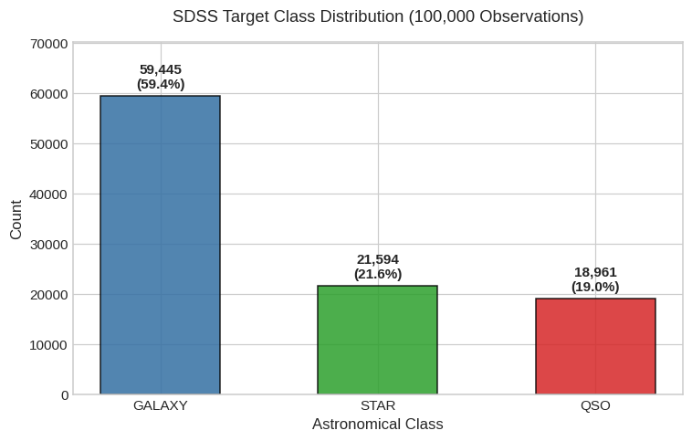
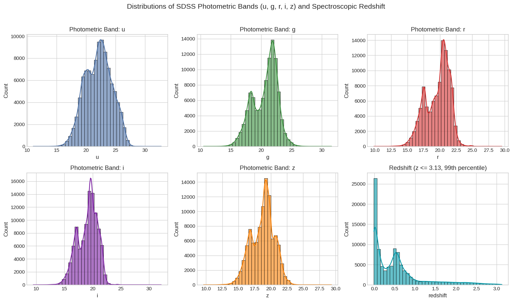
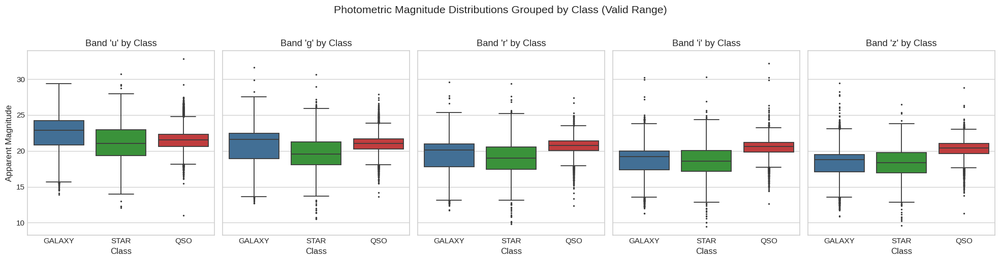
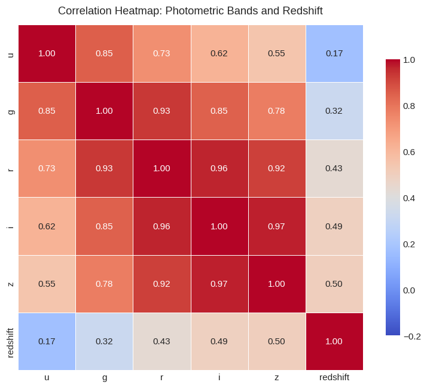
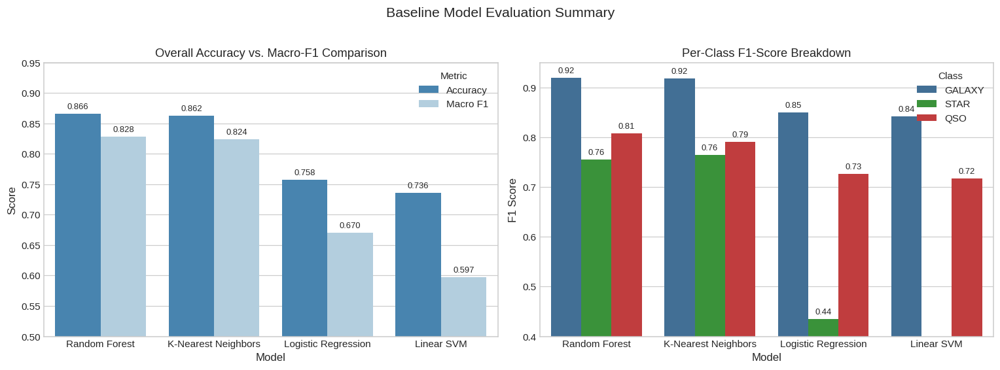
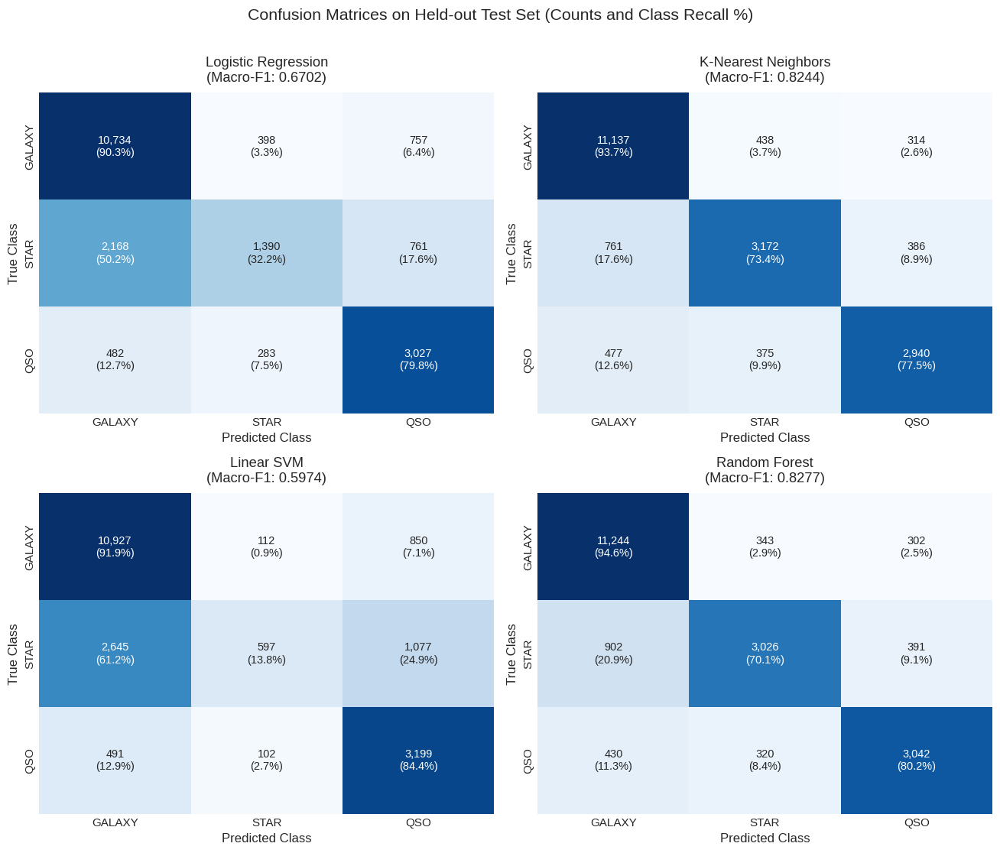

# Sloan Digital Sky Survey (SDSS): Stellar Object Classification
## Report 1: Baseline Photometric Classification

**Course Project:** Pattern Recognition  
**Experiment Sequence:** Phase 1 of 5 (Baseline Classification)  
**Source Notebook:** `01_sdss_baseline_classification.ipynb`  
**Execution Environment:** Python 3.11 / scikit-learn / CPU  

---

## Executive Summary

This report establishes the baseline machine learning benchmark for classifying astronomical observations from the Sloan Digital Sky Survey (SDSS Data Release 17) into three target classes: **Stars (`STAR`)**, **Galaxies (`GALAXY`)**, and **Quasars (`QSO`)**. In this opening phase, models rely exclusively on the five raw optical photometric passbands ($u, g, r, i, z$). Complex domain transformations, engineered color ratios, and spectroscopic redshift measurements are intentionally withheld.

Evaluating four standard machine learning algorithms on a held-out test set of 20,000 observations reveals a stark performance divide:
- Non-linear classifiers achieved strong predictive capabilities: **Random Forest** achieved the highest overall performance with an **Accuracy of 0.8656** and a **Macro F1-score of 0.8277**, followed closely by **K-Nearest Neighbors ($k=5$)** with an **Accuracy of 0.8625** and a **Macro F1-score of 0.8244**.
- Linear decision surfaces failed to separate the minority classes: **Logistic Regression** attained a **Macro F1-score of 0.6702** (Accuracy: 0.7575), and **Linear Support Vector Machine (Linear SVM)** attained a **Macro F1-score of 0.5974** (Accuracy: 0.7361). In particular, Linear SVM correctly identified only **13.82%** of stars in the test set.

These empirical results prove that astronomical objects are not linearly separable in raw apparent magnitude space. They establish a solid, transparent foundation against which subsequent feature engineering, ablation, selection, and uncertainty experiments will be measured.

---

## 1. Introduction

### 1.1 The Astronomical Classification Problem
Modern digital sky surveys observe hundreds of millions of celestial objects across large areas of the sky. Classifying these detections manually using human astronomers or dedicating spectroscopic telescope time to every object is physically and economically impossible. Machine learning pattern recognition offers an automated pipeline to categorize newly detected optical sources rapidly and accurately.

### 1.2 Target Astronomical Classes
The SDSS dataset categorizes observed celestial bodies into three distinct physical classes:

1. **Stars (`STAR`)**: Gravitationally bound spheres of hot plasma located within our own Milky Way galaxy. In optical imaging, stars appear as compact, diffraction-limited point sources of light with continuous thermal emission spectra marked by stellar absorption lines.
2. **Galaxies (`GALAXY`)**: Massive cosmic systems containing billions of stars, interstellar gas, dust, and dark matter. Spatially, galaxies appear as extended, fuzzy, and diffuse structures (such as spiral arms or elliptical halos) rather than sharp point sources.
3. **Quasars (`QSO` — Quasi-Stellar Objects)**: Extremely luminous active galactic nuclei powered by supermassive black holes accreting matter at relativistic speeds in the early universe. Because their central energy source completely outshines their distant host galaxies, quasars look identical to foreground stars on optical detectors (appearing as unresolved point sources), despite being billions of light-years away.

### 1.3 Baseline Objective and Research Question
The primary goal of this baseline experiment is to establish a rigorous performance benchmark using standard machine learning models trained strictly on raw optical photometry ($u, g, r, i, z$).

The central research question investigated is:
> *How effectively can standard baseline classifiers discriminate between stars, galaxies, and quasars using only raw five-band optical brightness measurements ($u, g, r, i, z$), and what specific failure modes occur when color indices and spectroscopic redshift are withheld?*

---

## 2. Dataset Description and Preprocessing

### 2.1 Dataset Overview and Attributes
The dataset contains **100,000 observations** and **18 columns** from SDSS Data Release 17. Each record represents an optical detection with associated tracking metadata, celestial coordinates, photometric filter measurements, and spectroscopic verification.

| Attribute | Data Type | Physical / Survey Role | Baseline Action | Justification |
| :--- | :--- | :--- | :--- | :--- |
| `obj_ID` | float64 | Photometric detection tracking key | **Excluded** | Arbitrary database index; causes spurious memorization. |
| `alpha` | float64 | Right Ascension (celestial longitude) | **Excluded** | Sky position coordinate; prevents spatial bias. |
| `delta` | float64 | Declination (celestial latitude) | **Excluded** | Sky position coordinate; prevents spatial bias. |
| `u` | float64 | Ultraviolet filter magnitude (~355 nm) | **Included** | Core optical photometric baseline feature. |
| `g` | float64 | Green optical filter magnitude (~468 nm) | **Included** | Core optical photometric baseline feature. |
| `r` | float64 | Red optical filter magnitude (~616 nm) | **Included** | Core optical photometric baseline feature. |
| `i` | float64 | Near-Infrared filter magnitude (~748 nm) | **Included** | Core optical photometric baseline feature. |
| `z` | float64 | Infrared filter magnitude (~893 nm) | **Included** | Core optical photometric baseline feature. |
| `run_ID` | int64 | Survey imaging run number | **Excluded** | Instrument survey metadata. |
| `rerun_ID` | int64 | Reprocessing pipeline version | **Excluded** | Constant metadata parameter (301 across all rows). |
| `cam_col` | int64 | Camera CCD column | **Excluded** | Instrument hardware parameter. |
| `field_ID` | int64 | Field identification number | **Excluded** | Survey tiling parameter. |
| `spec_obj_ID` | float64 | Unique spectroscopic record ID | **Excluded** | Unique spectrum ID; used solely for duplicate audits. |
| `class` | object | Astronomical classification | **Target ($y$)** | Prediction target (`GALAXY`, `STAR`, `QSO`). |
| `redshift` | float64 | Spectroscopic redshift | **Excluded** | Reserved for Phase 3 ablation study. |
| `plate` | int64 | Spectrograph plate number | **Excluded** | Hardware tracking identifier. |
| `MJD` | int64 | Modified Julian Date (timestamp) | **Excluded** | Observation scheduling timestamp. |
| `fiber_ID` | int64 | Optical fiber plate position | **Excluded** | Instrument hardware parameter. |

### 2.2 Missing-Value and Data Quality Audit
A systematic programmatic audit of the initial 100,000 records confirmed:
- **Zero explicit missing values**: Across all 18 columns, there were no null or `NaN` entries.
- **Zero duplicate rows**: No duplicate records existed across the entire feature set.
- **Identifier integrity**: All 100,000 records possessed completely unique spectroscopic IDs (`spec_obj_ID`). While some repeated photometric object IDs (`obj_ID`) appeared due to repeated telescope exposures (78,052 unique IDs), they correspond to independent physical measurements.

### 2.3 Unphysical Sentinel Value Detection and Removal
Astronomical magnitudes represent optical flux on a logarithmic scale ($m = -2.5 \log_{10}(F/F_0)$). Standard SDSS apparent magnitudes typically range between 12 and 26. 

Summary statistics revealed that the minimum value recorded for the `u`, `g`, and `z` bands was **`-9999.000000`**. In SDSS data pipelines, `-9999.0` is an astronomical sentinel value denoting a failed exposure, sensor saturation, or corrupted pipeline extraction. Exactly one observation in the dataset (index **79543**, an object classified as `STAR` with `obj_ID = 1.237649e+18`) contained this corrupted value. 

Leaving this observation in the dataset would severely distort data standardization (calculating inaccurate means and standard deviations) and misguide distance metrics. This single row was removed, resulting in a clean, physically valid baseline dataset of **99,999 observations**.

---

## 3. Exploratory Data Analysis (EDA)

### 3.1 Target Class Distribution
The target variable exhibits noticeable class imbalance across the 99,999 valid observations:
- **`GALAXY`**: 59,445 observations (**59.45%**)
- **`STAR`**: 21,594 observations (**21.59%**)
- **`QSO` (Quasar)**: 18,960 observations (**18.96%**)

*Figure 1: Distribution of target classes across the 99,999 clean observations. Galaxies represent the majority class (~59.5%), while stars (~21.6%) and quasars (~19.0%) form substantial minority classes.*

**Plain-English Interpretation:**  
The dataset is imbalanced. Nearly 6 out of every 10 objects are galaxies. If a simple rule-of-thumb model unconditionally guessed "Galaxy" for every object, it would achieve an apparent accuracy of 59.45% while completely failing to detect stars or quasars. For this reason, overall accuracy is a deceptive metric. We must use the **Macro-averaged F1-score** (which treats all three classes equally, regardless of size) as our primary metric.

### 3.2 Distributions of Photometric Bands and Redshift
We examined the numerical distribution of each raw photometric passband alongside spectroscopic redshift.

*Figure 2: Histograms and kernel density estimates for the five optical photometric bands ($u, g, r, i, z$) and spectroscopic redshift ($z \le 3.5$, 99th percentile).*

**Key Observations:**
1. The optical bands ($g, r, i, z$) follow bell-shaped distributions centered between magnitudes 18 and 21. 
2. The ultraviolet band ($u$) is shifted toward fainter values (higher magnitudes, median 22.18) because celestial objects emit less ultraviolet flux and atmospheric absorption is stronger at ~355 nm.
3. Spectroscopic redshift has a heavy right tail extending up to $z = 7.01$, with a median of 0.42. Because redshift directly reflects cosmological distance, it was excluded from this baseline experiment to evaluate pure optical photometry.

### 3.3 Class-Wise Photometric Comparisons
To determine whether raw brightness alone can separate the classes, we plotted boxplots of each band grouped by astronomical class.

*Figure 3: Class-grouped boxplots across the five photometric bands ($u, g, r, i, z$). Stars (green), galaxies (blue), and quasars (red) display substantial median differences in specific bands, but also major overlap.*

**Key Observations:**
- **Stars** exhibit lower numerical values (meaning they are brighter) in the red and near-infrared bands ($r, i, z$) compared to galaxies and quasars, with a median $r$ magnitude of ~18.1.
- **Galaxies** show a steep gradient across bands: faint in ultraviolet ($u \approx 22.5$) and relatively bright in infrared ($z \approx 18.5$).
- **Quasars** stay relatively flat across the middle bands ($g \approx 20.9, r \approx 20.5$), but overlap substantially with the fainter end of the stellar population and the brighter end of the galaxy population.

### 3.4 Correlation Analysis
We computed Pearson correlation coefficients between the five photometric bands and redshift.

*Figure 4: Correlation heatmap of photometric passbands and redshift. Adjacent optical and infrared filters exhibit strong linear collinearity ($r = 0.94$ to $0.98$).*

**Key Observations:**
- Adjacent filters exhibit extreme collinearity: $g$ and $r$ have a correlation of **0.96**, $r$ and $i$ have **0.98**, and $i$ and $z$ have **0.97**. This occurs because an object that is bright in red light is almost always bright in green and infrared light.
- Redshift exhibits weak linear correlations with raw magnitudes ($r = -0.05$ to $0.07$), indicating that any predictive power in redshift is non-linear or related to spectral shape rather than overall brightness.

---

## 4. Methodology

### 4.1 Stratified Train/Test Split
To prevent data leakage and evaluate real-world generalization, the 99,999 observations were partitioned using an **80/20 stratified split** (`stratify=y`, `random_state=42`):
- **Training Set**: 79,999 observations (59.45% Galaxy, 21.59% Star, 18.96% Quasar)
- **Test Set**: 20,000 observations (59.44% Galaxy, 21.60% Star, 18.96% Quasar)

Stratification ensures that the relative proportions of Stars, Galaxies, and Quasars in the test set mirror the training data exactly.

### 4.2 Explicit Feature Standardization
Distance-based algorithms (like KNN) and gradient-based algorithms (like Logistic Regression and SVM) are sensitive to feature scales. If features are not standardized, a band with larger variance would dominate the distance calculations.

To guarantee zero data leakage:
1. A `StandardScaler` was fitted **strictly on the 79,999 training observations** to compute training means and standard deviations.
2. The learned parameters were applied to transform both `X_train` and `X_test`.
3. Standardized parameters were verified: training features achieved exact mean $0.0$ and standard deviation $1.0$. On the test set, means stayed between $0.0005$ and $0.0153$, and standard deviations stayed between $0.9953$ and $1.0053$.
4. Decision trees and Random Forests do not rely on Euclidean distance and are invariant to monotonic scaling, so Random Forest was evaluated on unscaled inputs.

### 4.3 Baseline Machine Learning Classifiers
We evaluated four standard classification algorithms representing distinct mathematical paradigms:

1. **Multinomial Logistic Regression**:
   - *Mechanics:* Linear model computing log-odds ratios using a cross-entropy loss function (`max_iter=1000`, `solver='lbfgs'`). Standardized inputs.
   - *Purpose:* Establishes the baseline linear decision boundary benchmark.
2. **K-Nearest Neighbors (KNN)**:
   - *Mechanics:* Non-parametric instance-based classifier assigning labels based on the majority vote of the $k=5$ closest training points using Euclidean distance (`n_jobs=-1`). Standardized inputs.
   - *Purpose:* Tests whether local neighborhood clustering can capture non-linear relationships.
3. **Linear Support Vector Machine (`LinearSVC`)**:
   - *Mechanics:* Constructs maximum-margin hyperplanes between classes using the LIBLINEAR solver (`dual='auto'`, `max_iter=2000`). Standardized inputs.
   - *Purpose:* Evaluates strict linear separability with margin maximization.
4. **Random Forest Classifier**:
   - *Mechanics:* Non-linear ensemble of 100 decorrelated decision trees (`max_depth=15`, `min_samples_split=5`, `random_state=42`, `n_jobs=-1`). Unscaled inputs.
   - *Purpose:* Evaluates hierarchical, axis-aligned recursive partitioning capable of capturing non-linear interactions.

### 4.4 Evaluation Metrics
To provide an honest, thorough assessment under class imbalance, we report:
- **Accuracy**: The fraction of total predictions that are correct.
- **Macro Precision**: The unweighted mean of precision across all three classes.
- **Macro Recall**: The unweighted mean of recall across all three classes.
- **Macro F1-Score**: The harmonic mean of Macro Precision and Macro Recall ($2 \cdot \frac{P \cdot R}{P + R}$), treating every astronomical class with equal importance.
- **Per-Class F1-Scores**: Class-specific harmonic scores for `GALAXY`, `STAR`, and `QSO`.

---

## 5. Experimental Results

### 5.1 Comparative Model Performance
All four baseline models were trained and evaluated on the identical 20,000 held-out test observations. Table 1 presents the exact measured numerical results, sorted by Macro F1-score.

| Model | Accuracy | Macro Precision | Macro Recall | Macro F1 | Train Time (s) | Predict Time (s) | F1 (GALAXY) | F1 (STAR) | F1 (QSO) |
| :--- | :---: | :---: | :---: | :---: | :---: | :---: | :---: | :---: | :---: |
| **Random Forest** | **0.8656** | **0.8429** | **0.8162** | **0.8277** | 33.84 s | 0.27 s | **0.9192** | 0.7557 | **0.8083** |
| **K-Nearest Neighbors ($k=5$)** | 0.8625 | 0.8345 | 0.8155 | 0.8244 | 0.37 s | 0.57 s | 0.9180 | **0.7640** | 0.7912 |
| **Logistic Regression** | 0.7575 | 0.7131 | 0.6743 | 0.6702 | 1.63 s | 0.002 s | 0.8494 | 0.4351 | 0.7262 |
| **Linear SVM** | 0.7361 | 0.7124 | 0.6336 | 0.5974 | 0.57 s | 0.003 s | 0.8421 | 0.2327 | 0.7174 |

*Table 1: Measured performance comparison across the four baseline models on 20,000 held-out test observations using raw 5-band photometry ($u, g, r, i, z$).*

*Figure 5: Side-by-side performance comparison. Left: Overall Accuracy versus Macro F1-score across all four classifiers. Right: Per-class F1-score breakdown showing the dramatic performance drop on stars for linear classifiers.*

### 5.2 Confusion Matrix and Per-Class Breakdown
To understand where models succeed and fail, we analyzed the confusion matrices across all 20,000 test observations (containing 11,889 Galaxies, 4,319 Stars, and 3,792 Quasars).

*Figure 6: Confusion matrices for all four baseline classifiers on the 20,000 test observations, annotated with raw counts and true-class recall percentages.*

#### Detailed Error Analysis for Random Forest (Top Model):
Random Forest produced **2,688 errors** out of 20,000 predictions (an error rate of **13.44%**):
- **Galaxies (Support: 11,889)**: 11,244 correctly classified (**94.57% recall**). Only 302 were misclassified as Quasars and 343 as Stars.
- **Quasars (Support: 3,792)**: 3,042 correctly classified (**80.22% recall**). 430 were misclassified as Galaxies and 320 as Stars.
- **Stars (Support: 4,319)**: 3,026 correctly classified (**70.06% recall**). 902 were misclassified as Galaxies and 391 as Quasars.

#### The Failure Mode of Linear Classifiers:
- **Logistic Regression**: Correctly classified 10,735 Galaxies (90.29% recall) and 3,027 Quasars (79.83% recall), but correctly detected only **1,390 Stars (32.18% recall)**. The model misclassified 2,168 Stars as Galaxies.
- **Linear SVM**: Suffered an even more severe breakdown. It identified only **597 Stars out of 4,319 (13.82% recall)**, with an F1-score of just **0.2327**. Over 2,395 stars were incorrectly labeled as galaxies.

---

## 6. Discussion

### 6.1 The Non-Linearity Divide
The experimental findings demonstrate a clear mathematical dividing line between model families:
1. **Non-linear models (Random Forest and KNN)** achieved Macro F1-scores of ~0.828 and ~0.824, outperforming linear models by **15.75 to 23.03 percentage points**.
2. **Linear models (Logistic Regression and Linear SVM)** struggled substantially, reaching Macro F1-scores of only ~0.670 and ~0.597.

This large performance gap proves that the boundaries between Stars, Galaxies, and Quasars in five-dimensional raw magnitude space are curved and intertwined. A flat, planar hyperplane cannot separate stars from galaxies without incorrectly sweeping vast portions of the stellar population into the galaxy class.

### 6.2 Which Classes Are Easiest and Hardest to Classify?
- **Easiest: `GALAXY`**: Every model achieved its highest F1-score on Galaxies (0.8421 to 0.9192). This is partly due to sample size (Galaxies constitute 59.45% of the data) and partly because extended, multi-component galactic light profiles produce distinct photometric magnitude signatures compared to compact sources.
- **Hardest: `STAR` and `QSO` Confusion**: Stars proved to be the most challenging class for linear models, while Quasars exhibited substantial confusion with both Stars and Galaxies. In Random Forest, 320 Quasars were mistaken for Stars and 391 Stars were mistaken for Quasars.

### 6.3 Physical Reason for Confusion: Distance-Flux Degeneracy
Why do stars and quasars overlap so heavily in raw magnitude space?
In observational astronomy, apparent magnitude measures the light flux ($F$) arriving at the telescope detector. This flux depends on two distinct factors: the object's intrinsic luminosity ($L$) and its distance from Earth ($d$), governed by the inverse-square law:
$$F = \frac{L}{4 \pi d^2}$$

A modest, relatively dim star located close to us inside the Milky Way can deliver the exact same amount of light to the telescope as an extraordinarily luminous quasar located billions of light-years away. When classifiers are given only raw brightness measurements without distance indicators or color ratios, they cannot disentangle a faint nearby point source from a brilliant distant point source.

### 6.4 Computational Efficiency
Computational profiling indicates that all four baseline models are efficient on standard CPU hardware:
- **Random Forest** took the longest to train (**33.84 s**) due to building 100 deep trees, but produced fast test predictions (**0.27 s** for 20,000 samples).
- **KNN** trained almost instantaneously (**0.37 s**) but required **0.57 s** to predict, reflecting the computational cost of calculating Euclidean distances across 20,000 query samples against 79,999 reference points.
- **Linear models** trained in under 2 seconds and generated predictions in 2 to 3 milliseconds.

---

## 7. Baseline Limitations and Project Outlook

### 7.1 Limitations of Raw Photometry
1. **Lack of Scale Invariance**: Raw magnitudes shift up or down purely based on distance, obscuring intrinsic spectral shapes.
2. **Residual Star/Quasar Confusion**: 13.44% of test observations were misclassified by the best baseline model, primarily because point-like quasars mimic stars in broadband filters.
3. **Severe Linear Underperformance**: Linear models cannot be deployed in raw magnitude space without feature transformations.

### 7.2 Connection to Subsequent Project Phases
This baseline experiment establishes the empirical starting point for the remaining four phases:
- **Phase 2 (Color Feature Engineering)**: Tests whether deriving scale-free color indices ($u-g, g-r, r-i, i-z$) cancels out distance dependencies and improves class separation.
- **Phase 3 (Redshift Ablation Study)**: Introduces spectroscopic redshift to quantify the exact value of distance information in eliminating star/quasar confusion.
- **Phase 4 (Feature Selection & Importance)**: Uses tree-based impurity and permutation importance to find the smallest competitive feature subset.
- **Phase 5 (Uncertainty & Error Analysis)**: Investigates prediction confidence, probability calibration, and selective prediction (abstention) on ambiguous borderline cases.

---

## 8. Conclusion

Phase 1 successfully established an end-to-end baseline pattern recognition benchmark for SDSS stellar object classification. 

Among the evaluated models, **Random Forest is the strongest baseline classifier**, achieving an **Accuracy of 86.56%** and a **Macro F1-score of 0.8277**, with **KNN ($k=5$)** finishing a close second (86.25% Accuracy, 0.8244 Macro F1). Linear classifiers proved unsuitable for raw photometric inputs, failing dramatically on the stellar class. 

These findings provide clear quantitative evidence that raw apparent brightness alone is insufficient for clean astronomical classification, setting a clear, transparent baseline for the feature engineering experiments in Phase 2.
