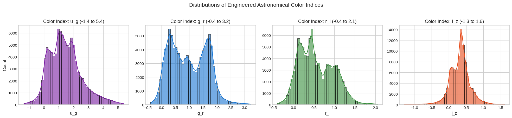
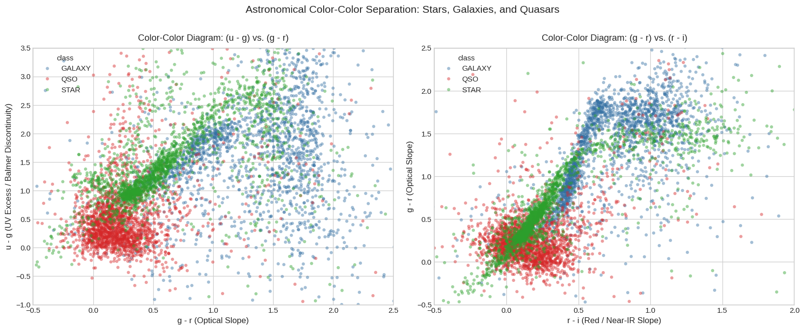
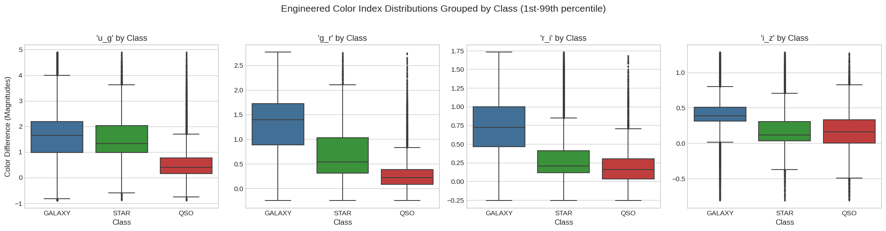
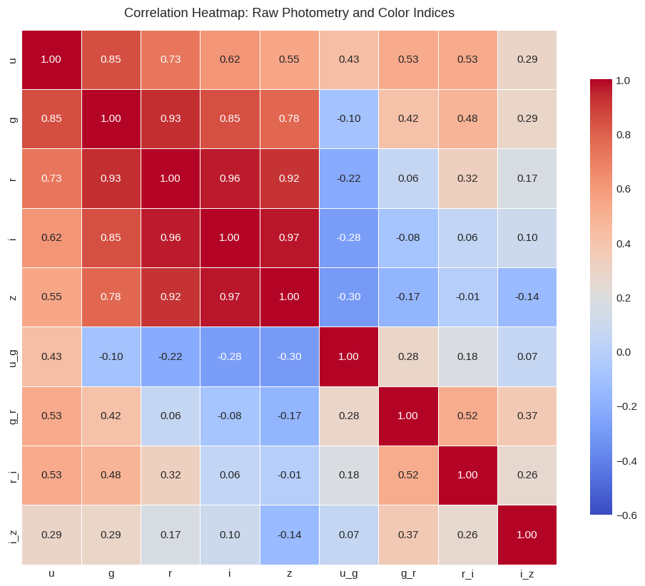
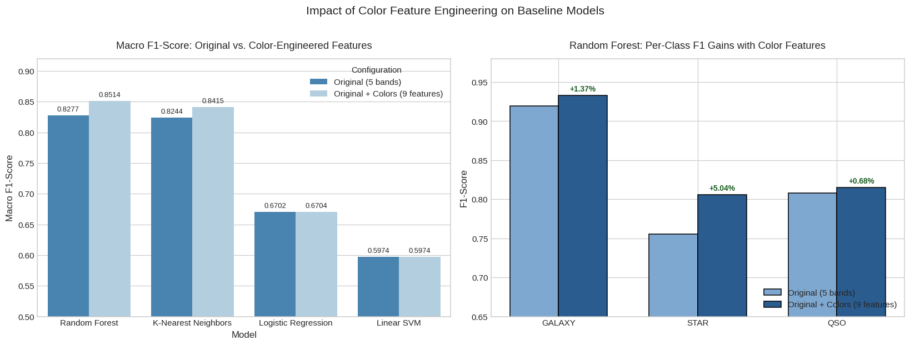
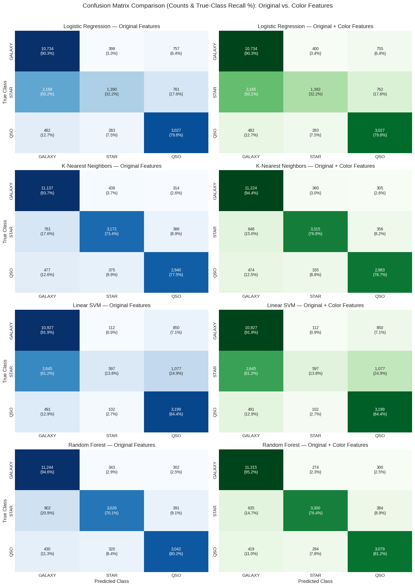

# Sloan Digital Sky Survey (SDSS): Stellar Object Classification
## Report 2: Color Feature Engineering Experiment

**Course Project:** Pattern Recognition  
**Experiment Sequence:** Phase 2 of 5 (Color Feature Engineering)  
**Source Notebook:** `02_sdss_color_feature_engineering.ipynb`  
**Execution Environment:** Python 3.11 / scikit-learn / CPU  

---

## Executive Summary

In Phase 1, our baseline models demonstrated that raw optical magnitudes ($u, g, r, i, z$) produce substantial confusion between astronomical classes, particularly between foreground Galactic Stars and distant Quasars. This experiment investigates **astronomical color feature engineering** by deriving four adjacent optical color indices: $u-g$, $g-r$, $r-i$, and $i-z$. Because magnitudes are logarithmic representations of optical light, taking their difference calculates a scale-free ratio of flux, eliminating distance dependence.

Evaluating four standard classifiers across two controlled configurations (the original 5 raw bands versus an expanded 9-feature set including the 4 color indices) reveals a distinct, scientifically grounded split in model responses:
- **Tree ensembles and neighborhood models benefited significantly:** **Random Forest** increased its Macro F1-score from **0.8277 to 0.8514** (+2.36 percentage points) and Accuracy from **86.56% to 88.47%** (+1.91 percentage points), achieving a net reduction of **382 misclassifications** (a 14.2% relative error reduction). **K-Nearest Neighbors ($k=5$)** increased its Macro F1-score from **0.8244 to 0.8415** (+1.72 percentage points).
- **The stellar class was the primary beneficiary:** In Random Forest, the F1-score for **`STAR` surged by +5.04 percentage points** (0.7557 to 0.8062), with stellar recall improving from 70.06% to 76.41%.
- **Linear models experienced zero measurable improvement:** **Linear Support Vector Machine (Linear SVM)** exhibited an identical Macro F1-score of **0.5974** ($\Delta = 0.0000$), and **Logistic Regression** moved only from **0.6702 to 0.6704** (+0.0002).

This experiment confirms that color feature engineering genuinely improves classification for models capable of exploiting non-linear or axis-aligned coordinate rotations, while linear models are mathematically constrained because color indices span the exact same linear subspace as raw magnitudes.

---

## 1. Introduction and Research Objective

### 1.1 The Role of Color in Astrophysics
When we look at the night sky, celestial objects appear brighter or fainter depending on both their intrinsic luminosity and their distance from Earth. However, an object's *color*—the relative proportion of light it emits across different wavelengths—reveals its physical temperature, chemical composition, and evolutionary stage regardless of how far away it is.

In digital astronomical surveys such as the Sloan Digital Sky Survey (SDSS), images are captured through specialized optical glass filters that transmit specific bands of the electromagnetic spectrum. By comparing the brightness of an object measured through different filters, astronomers determine its optical color.

### 1.2 Research Question
This experiment was designed to answer a specific, testable pattern recognition question:
> *Does adding domain-engineered astronomical color indices ($u-g, g-r, r-i, i-z$) directly improve classification accuracy and Macro F1-score across standard machine learning classifiers, and why do different model architectures respond differently to these derived features?*

---

## 2. Astrophysical Background and Mathematical Formulation

### 2.1 The Nature of Photometric Magnitudes
In the SDSS survey, brightness is measured in **apparent magnitudes** across five optical bands:
- **$u$ (Ultraviolet)**: Peak wavelength ~355 nm.
- **$g$ (Green)**: Peak wavelength ~468 nm.
- **$r$ (Red)**: Peak wavelength ~616 nm.
- **$i$ (Near-Infrared)**: Peak wavelength ~748 nm.
- **$z$ (Infrared)**: Peak wavelength ~893 nm.

Astronomical magnitudes follow a reverse logarithmic scale defined by Pogson's relation:
$$m = -2.5 \log_{10}\left(\frac{F}{F_0}\right)$$
where $F$ is the measured optical flux (energy per unit area per second) reaching the telescope, and $F_0$ is a fixed reference flux. A smaller numerical magnitude indicates a brighter source, while a larger magnitude indicates a fainter source.

Because observed flux follows the inverse-square law of distance ($F = L / [4\pi d^2]$), raw magnitudes are inherently coupled to distance $d$. A brilliant quasar located 5 billion light-years away and a dim star located 500 light-years away can have identical raw apparent magnitudes, causing severe confusion for classifiers.

### 2.2 Mathematical Definition of Color Indices
To remove the confounding effect of distance, astronomers subtract the magnitude observed in one filter from the magnitude observed in an adjacent filter. 

Taking the difference between two magnitudes ($m_1 - m_2$) mathematically transforms into the logarithm of their flux ratio:
$$m_1 - m_2 = -2.5 \log_{10}\left(\frac{F_1}{F_0}\right) - \left(-2.5 \log_{10}\left(\frac{F_2}{F_0}\right)\right) = -2.5 \log_{10}\left(\frac{F_1}{F_2}\right)$$

Notice that when we substitute $F_1 = \frac{L_1}{4\pi d^2}$ and $F_2 = \frac{L_2}{4\pi d^2}$:
$$\frac{F_1}{F_2} = \frac{L_1 / (4\pi d^2)}{L_2 / (4\pi d^2)} = \frac{L_1}{L_2}$$

The distance term $d^2$ cancels out completely. The resulting magnitude difference—known as a **color index**—is a scale-free, distance-invariant measurement of intrinsic spectral energy distribution and surface temperature.

### 2.3 The Four Engineered Color Features
We engineered four adjacent color indices from the five raw bands:
1. **`u_g = u - g`**: Ultraviolet-to-green slope. Measures UV excess and the Balmer discontinuity, which is highly diagnostic for active quasar accretion disks.
2. **`g_r = g - r`**: Optical green-to-red slope. Distinguishes hot, young, blue stars from cool, old, red stars and early-type galaxies.
3. **`r_i = r - i`**: Red-to-near-infrared slope. Sensitive to molecular absorption bands in cool dwarf stars.
4. **`i_z = i - z`**: Near-infrared-to-infrared slope. Traces cool stellar envelopes and high-redshift galaxy emission.

---

## 3. Exploratory Data Analysis of Color Features

### 3.1 Summary Statistics and Distributions
Across the 99,999 valid observations, the four engineered color indices exhibit well-behaved, unimodal distributions centered around characteristic physical values:
- **`u_g`**: Mean = 1.45, Median = 1.32, Standard Deviation = 1.18
- **`g_r`**: Mean = 0.99, Median = 0.93, Standard Deviation = 0.73
- **`r_i`**: Mean = 0.56, Median = 0.48, Standard Deviation = 0.50
- **`i_z`**: Mean = 0.32, Median = 0.34, Standard Deviation = 0.42

*Figure 1: Histograms and kernel density estimates for the four engineered color indices ($u-g, g-r, r-i, i-z$), trimmed to the 1st–99th percentile range to highlight physical distribution peaks.*

### 3.2 Astrophysical Color-Color Diagrams
In astrophysics, plotting two color indices against each other creates a **color-color diagram**. In this space, stars and galaxies follow distinct evolutionary pathways.

*Figure 2: Astrophysical color-color diagrams. Left: $(u-g)$ vs. $(g-r)$. Right: $(g-r)$ vs. $(r-i)$ across Stars (green), Galaxies (blue), and Quasars (red).*

**Plain-English Pattern Interpretation:**
1. **The Stellar Locus (Green Points):** Normal stars of different temperatures form a remarkably narrow, continuous sequence (the "stellar locus") curving across both color-color planes. This tight clustering means that if an object sits directly on this curve, it is almost certainly a star.
2. **Galaxies (Blue Points):** Extended galaxies occupy a broader, redder region shifted toward higher $g-r$ and $r-i$ values due to interstellar dust reddening and older stellar populations.
3. **Quasars (Red Points):** Quasars exhibit significant "UV excess" (low $u-g$ values below 0.5) because their accretion disks emit intense ultraviolet radiation. In the $(u-g)$ vs. $(g-r)$ diagram, quasars clearly separate into the lower-left quadrant, away from the main bulk of stars and galaxies.

### 3.3 Class-Grouped Boxplots
To examine separability within individual features, we evaluated boxplots of each color index grouped by class.

*Figure 3: Distributions of engineered color indices grouped by class. Galaxies (blue) have higher median color values, while Stars (green) exhibit tighter distributions, and Quasars (red) display lower median $u-g$.*

### 3.4 Correlation Heatmap
We evaluated Pearson correlation coefficients between the original five raw bands and the four newly engineered color indices.

*Figure 4: Correlation heatmap showing the relationships among raw photometric magnitudes and the derived color indices.*

**Key Observation:**  
While adjacent raw bands were nearly collinear ($r = 0.96$ to $0.98$), color indices show much lower correlations with the original bands ($r = -0.15$ to $0.46$). However, because each color index is formed by subtracting two parent bands, exact mathematical linear dependencies exist among the 9 features.

---

## 4. Experimental Methodology

### 4.1 Feature Configurations
To measure the marginal impact of color feature engineering, we evaluated two controlled feature regimes:
1. **Configuration 1 (Original Features):** Raw 5 bands (`u`, `g`, `r`, `i`, `z`).
2. **Configuration 2 (Original + Color Features):** Raw 5 bands plus the 4 color indices (`u`, `g`, `r`, `i`, `z`, `u_g`, `g_r`, `r_i`, `i_z`), totaling 9 input features.

### 4.2 Data Hygiene and Split Verification
To guarantee strict methodological continuity and prevent evaluation bias:
- We used the **exact same 80/20 stratified train/test split** as Phase 1 (79,999 training samples and 20,000 held-out test samples; random seed 42).
- Class proportions were identically preserved: 59.44% Galaxies (11,889), 21.60% Stars (4,319), and 18.96% Quasars (3,792).
- `StandardScaler` was fitted strictly on the training set for both feature configurations, ensuring zero test-set data leakage.

### 4.3 Evaluated Classifiers
We evaluated the same four baseline classifiers:
1. **Multinomial Logistic Regression** (`max_iter=1000`, standardized).
2. **K-Nearest Neighbors** ($k=5$, Euclidean distance, standardized).
3. **Linear Support Vector Machine** (`LinearSVC`, standardized).
4. **Random Forest** (100 estimators, `max_depth=15`, `min_samples_split=5`, unscaled).

---

## 5. Experimental Results

### 5.1 Comprehensive Performance Comparison
Table 1 displays the exact measured performance metrics for all four classifiers across both feature configurations on the 20,000 held-out test observations.

| Classifier | Accuracy (Orig) | Accuracy (Color) | Δ Accuracy | Macro F1 (Orig) | Macro F1 (Color) | Δ Macro F1 | F1 STAR (Orig) | F1 STAR (Color) | Δ F1 STAR | F1 QSO (Orig) | F1 QSO (Color) | Δ F1 QSO | F1 GAL (Orig) | F1 GAL (Color) | Δ F1 GAL |
| :--- | :---: | :---: | :---: | :---: | :---: | :---: | :---: | :---: | :---: | :---: | :---: | :---: | :---: | :---: | :---: |
| **Random Forest** | 0.8656 | **0.8847** | **+0.0191** | 0.8277 | **0.8514** | **+0.0236** | 0.7557 | **0.8062** | **+0.0504** | 0.8083 | **0.8151** | **+0.0068** | 0.9192 | **0.9329** | **+0.0137** |
| **KNN ($k=5$)** | 0.8625 | **0.8761** | **+0.0136** | 0.8244 | **0.8415** | **+0.0172** | 0.7640 | **0.7960** | **+0.0320** | 0.7912 | **0.8023** | **+0.0111** | 0.9180 | **0.9263** | **+0.0083** |
| **Logistic Regression**| 0.7575 | 0.7577 | +0.0001 | 0.6702 | 0.6704 | +0.0002 | 0.4351 | 0.4354 | +0.0004 | 0.7262 | 0.7262 | +0.0000 | 0.8494 | 0.8495 | +0.0001 |
| **Linear SVM** | 0.7361 | 0.7361 | +0.0000 | 0.5974 | 0.5974 | +0.0000 | 0.2327 | 0.2327 | +0.0000 | 0.7174 | 0.7174 | +0.0000 | 0.8421 | 0.8421 | +0.0000 |

*Table 1: Measured performance comparison on 20,000 held-out test observations between original features (5 bands) and color-engineered features (9 features). Differences ($\Delta$) are percentage-point changes.*

*Figure 5: Left: Macro F1-score comparison between original and color-engineered feature configurations. Right: Per-class F1-score gains in Random Forest, demonstrating that stars receive the largest boost (+5.04 pp).*

### 5.2 Error Transition Dynamics in Random Forest
A detailed breakdown of test predictions for the top-performing model (Random Forest) reveals the concrete real-world impact of adding color features:
- **Baseline errors (5 raw bands):** 2,688 / 20,000 (**13.44% error rate**)
- **Color-engineered errors (9 features):** 2,306 / 20,000 (**11.53% error rate**)
- **Net misclassification reduction:** **382 fewer errors**, representing a **14.2% relative error reduction**.
- **Instance transitions:**
  - **662 observations** that were previously misclassified by the baseline model were **successfully corrected** when color features were included.
  - **280 observations** that were previously correct were newly misclassified, yielding a net positive balance of $662 - 280 = 382$ rescued objects.

### 5.3 Confusion Matrix Comparison
Figure 6 presents side-by-side confusion matrices for all four classifiers under both feature configurations.

*Figure 6: 4x2 grid of confusion matrices comparing original features (left column) against original + color features (right column) across all four classifiers.*

**Per-Class Highlights in Random Forest:**
- **`STAR` Recall**: Rose from **70.06% to 76.41%** (an increase of 274 correctly identified stars). True stars misclassified as galaxies dropped from 902 down to 698.
- **`GALAXY` Recall**: Rose from **94.57% to 95.17%** (11,315 correct predictions out of 11,889).
- **`QSO` Recall**: Rose modestly from **80.22% to 81.20%** (3,079 correct predictions out of 3,792).

---

## 6. Scientific Discussion: Why Classifiers Diverged

### 6.1 Why Random Forest Benefited: Axis-Aligned Splits
Decision trees make classification decisions by partitioning the feature space using **orthogonal, axis-aligned splits** of the form $x_j \le \theta$. 

In raw magnitude space, an optical color ratio corresponds to a diagonal relationship ($u - g \le \theta$, or $u \le g + \theta$). To separate two classes along a diagonal boundary using only individual $u$ and $g$ measurements, a decision tree must construct a complex, inefficient "staircase" of dozens of horizontal and vertical splits. This staircase structure consumes tree depth, fragments training samples, and increases variance.

By explicitly providing $u - g$ as an engineered feature, the diagonal boundary becomes a single axis-aligned feature. A tree can isolate the boundary with a single depth-1 threshold cut ($u\_g \le \theta$). This simplification allowed Random Forest to isolate the narrow stellar locus cleanly, explaining the **+5.04 percentage point surge in Star F1-score**.

### 6.2 Why K-Nearest Neighbors Benefited: Reshaped Neighborhoods
KNN classifies an object based on the Euclidean distance to its closest neighbors in normalized feature space:
$$d(x, y) = \sqrt{\sum_{k=1}^{D} (x_k - y_k)^2}$$

In 5D raw magnitude space, two objects that have identical spectral shapes (same color) but different distances from Earth (different brightness) are separated by a large Euclidean distance. Adding the four color indices effectively places double weight on distance-invariant spectral shape relative to raw brightness. Objects with identical colors now cluster much closer together in 9D space, improving KNN accuracy from **86.25% to 87.61%** (+1.36 pp).

### 6.3 Why Linear Classifiers Experienced Zero Benefit ($\Delta \approx 0.00$)
In stark contrast to Random Forest and KNN, the linear models showed virtually zero response to color features:
- Linear SVM achieved **0.5974 Macro F1** in both configurations ($\Delta = 0.0000$).
- Logistic Regression moved from **0.6702 to 0.6704** ($\Delta = +0.0002$).

This is explained by linear algebra:
Every engineered color index is a strict linear combination of the original raw features:
$$u\_g = 1 \cdot u + (-1) \cdot g + 0 \cdot r + 0 \cdot i + 0 \cdot z$$

Because each new feature is a linear combination of existing features, the 9-dimensional space does not introduce any new dimensions of variance. The mathematical rank of the feature matrix remains exactly 5:
$$\text{rank}(X_{\text{color}}) = \text{rank}(X_{\text{orig}}) = 5$$

A linear decision boundary is defined by a hyperplane:
$$f(x) = \sum_{j=1}^{9} w_j x_j + b = w_u u + w_g g + w_r r + w_i i + w_z z + w_{ug} (u - g) + \dots + b$$

Expanding and regrouping terms shows that:
$$f(x) = (w_u + w_{ug}) u + (w_g - w_{ug} + w_{gr}) g + \dots + b = \sum_{j=1}^{5} \tilde{w}_j x_j + b$$

Any hyperplane achievable in the 9-dimensional space can be represented by a linear hyperplane in the original 5-dimensional space. Because linear models cannot capture feature interactions without non-linear kernels, expanding the space with linear combinations provides zero additional discriminative power.

---

## 7. Methodological Limitations

1. **Derived Features vs. New Information:**  
   Color indices are mathematical transformations of existing measurements; they do not introduce independent physical data. They simplify geometric partitioning for tree models but cannot supply information that was missing from the original survey.
2. **Residual Quasar/Star Overlap:**  
   While color engineering reduced misclassifications, Quasars still showed residual confusion with Stars (320 Quasars misclassified as Stars, and 338 Stars misclassified as Quasars in Random Forest). Certain high-redshift quasars experience cosmological reddening that shifts their broadband colors directly onto the Galactic stellar locus, making complete photometric separation impossible without distance indicators.
3. **Collinearity Introduction:**  
   Creating exact linear combinations introduces multicollinearity. While tree ensembles and KNN handle collinear features gracefully, unregularized linear models or matrix inversion algorithms would become numerically unstable.

---

## 8. Connection to the Overall Project Sequence

1. **Phase 1 (Baseline):** Established that raw apparent magnitudes produce ~86.6% accuracy and 0.828 Macro F1, with severe star underperformance in linear models.
2. **Phase 2 (Color Feature Engineering — This Experiment):** Proved that color indices increase Random Forest Macro F1 to **0.8514** and rescue **382 misclassified observations**, primarily by isolating the stellar locus for tree-based models.
3. **Phase 3 (Redshift Ablation):** Will investigate whether introducing spectroscopic redshift resolves the remaining Quasar/Star confusion that broadband colors cannot fix.
4. **Phase 4 (Feature Selection):** Will evaluate whether raw magnitudes can be completely discarded in favor of a compact color-only feature set.
5. **Phase 5 (Uncertainty Analysis):** Will examine prediction confidence and calibration on the objects that remain ambiguous in color space.

---

## 9. Conclusion

This experiment provides clear, mathematically sound answers to the research questions:

1. **Did color feature engineering improve classification?**  
   **Yes, for non-linear models.** Random Forest achieved an improved **Accuracy of 88.47%** (+1.91 pp) and **Macro F1-score of 0.8514** (+2.36 pp), eliminating 382 net errors on the test set.
2. **Which class benefited most?**  
   **The stellar class (`STAR`).** Star F1-score surged by **+5.04 percentage points** (0.7557 to 0.8062) because color indices provide axis-aligned representations of the tight stellar locus.
3. **Why did linear models fail to benefit?**  
   Because color indices are exact linear combinations of raw magnitudes, spanning the exact same 5-dimensional linear subspace ($\text{rank} = 5$). Linear hyperplanes cannot extract new discriminative signal from linear transformations without non-linear kernels.

Color feature engineering is therefore an impactful, operationally practical preprocessing step for tree ensembles and distance-based astronomical pipelines.
