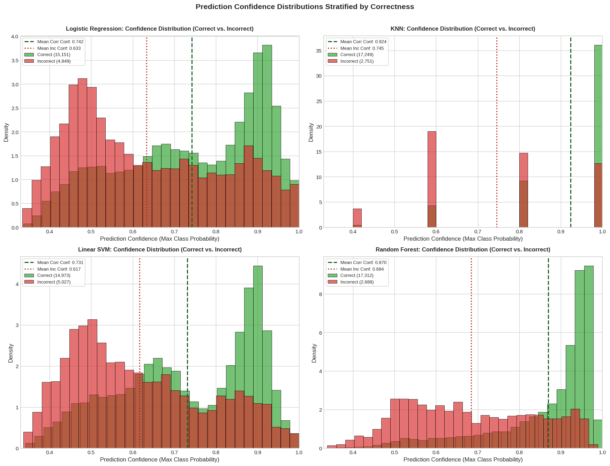
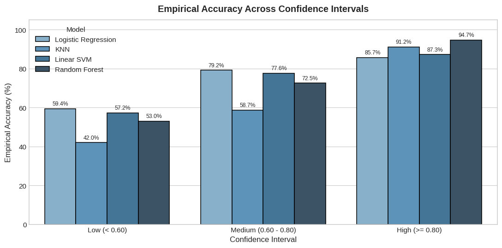
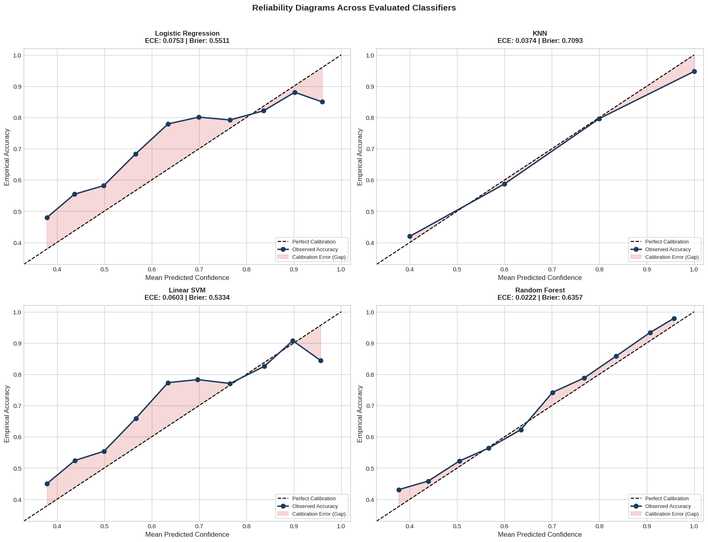
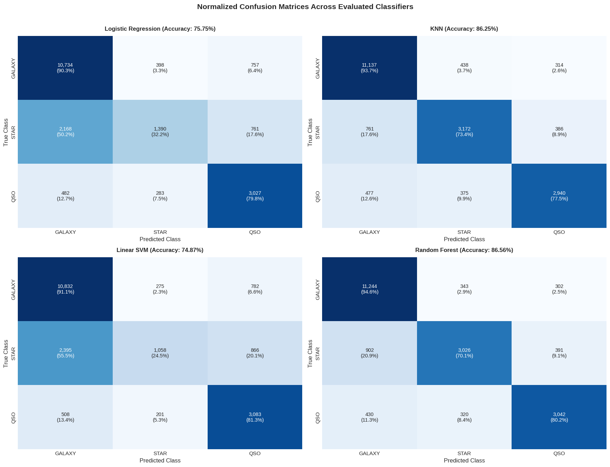
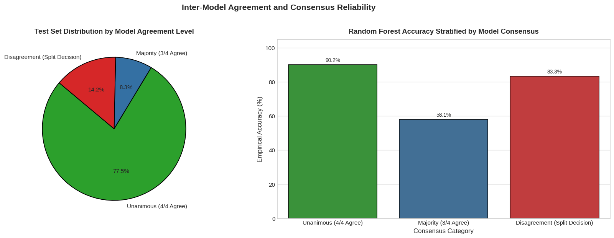
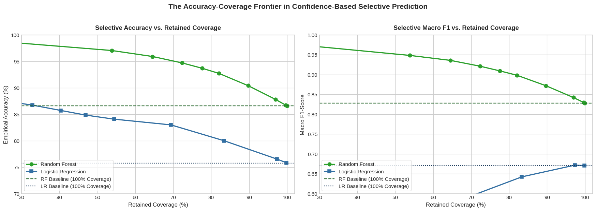
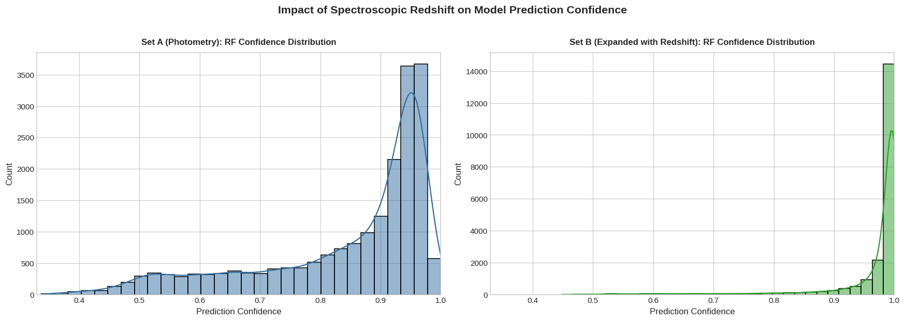

# Sloan Digital Sky Survey (SDSS): Stellar Object Classification
## Report 5: Prediction Uncertainty and Error Analysis

**Course Project:** Pattern Recognition  
**Experiment Sequence:** Phase 5 of 5 (Uncertainty & Error Analysis)  
**Source Notebook:** `05_sdss_uncertainty_analysis.ipynb`  
**Execution Environment:** Python 3.11 / scikit-learn / CPU  

---

## Executive Summary

Across the preceding four phases of this project, models were evaluated primarily on hard, discrete class labels (`STAR`, `GALAXY`, `QSO`). However, in operational astronomical pipelines, treating every prediction as equally certain is dangerous: an autonomous alert broker that triggers expensive spectroscopic telescope follow-up on a false prediction wastes valuable observational resources, while discarding genuine high-energy transients due to ambiguous scores delays critical discoveries.

This report investigates **prediction uncertainty, probability calibration, and selective prediction** using 20,000 held-out test observations from SDSS Data Release 17. By examining posterior class probabilities, Platt-calibrated decision margins, inter-model consensus, and abstention thresholds, our key empirical findings establish:
- **Confidence Strongly Correlates with Correctness:** For Random Forest, predictions made with high confidence ($\ge 80\%$) achieve an empirical accuracy of **94.70%** (error rate: 5.30%), whereas predictions in the low-confidence regime ($< 60\%$) achieve an accuracy of only **53.02%** (error rate: 46.98%). Mean confidence on correct test instances was **0.8698**, compared to **0.6842** on misclassified instances.
- **Random Forest is Naturally Well-Calibrated:** Random Forest achieved an **Expected Calibration Error (ECE) of 0.0222 (2.22%)**, significantly outperforming Platt-calibrated Linear SVM (ECE = 0.0603) and Logistic Regression (ECE = 0.0753).
- **Consensus Segregates Clean Data from Edge Cases:** On the **77.47%** of test samples where all four models unanimously agreed, collective accuracy was **90.20%**. On split decisions (14.23% of samples), non-linear models retained over **82% accuracy**, while linear models collapsed to **~12.5% accuracy**.
- **Selective Prediction Establishes a Purity-Coverage Frontier:** Rejecting ambiguous predictions based on confidence threshold $\tau$ allows astronomers to trade survey coverage for purity. Setting $\tau = 0.80$ retains **72.34% coverage** while elevating empirical accuracy from **86.56% to 94.70%** and Macro F1 from **0.83 to 0.92**. Setting $\tau = 0.95$ yields **98.58% accuracy** at 27.20% coverage.
- **High Confidence Does Not Guarantee Correctness:** Overconfident misclassifications persist on blended sources and high-redshift anomalies (e.g. an extreme high-redshift quasar at $z = 6.50$ misclassified as a galaxy with 90.06% confidence).

---

## 1. Introduction and Objectives

### 1.1 The Operational Danger of Hard Predictions
Standard machine learning classifiers output discrete category assignments: an object is labeled a Star, a Galaxy, or a Quasar. In real-world survey astronomy, this winner-take-all approach hides vital information:
- A prediction made with 99.8% certainty is treated identically to a prediction made with 34.0% certainty (barely higher than a random guess).
- Borderline objects located in ambiguous parameter regions (such as the overlap between faint stars and distant quasars) are assigned hard labels without expressing doubt.
- Follow-up observatories cannot distinguish reliable classifications from noisy edge cases.

### 1.2 Core Research Objectives
This study addresses five specific experimental questions:
1. *How are prediction confidence scores distributed across correct and incorrect predictions?*
2. *Are predicted class probabilities mathematically calibrated (do predicted probabilities match empirical observation frequencies)?*
3. *What happens when different machine learning architectures disagree on a prediction?*
4. *Can we implement confidence-based selective prediction (abstention / rejection) to guarantee high-purity catalogs for follow-up studies?*
5. *Why do models occasionally output high confidence on incorrect predictions?*

---

## 2. Experimental Methodology

### 2.1 Posterior Probability Extraction Across Paradigms
We evaluated four classifiers on the identical 20,000 held-out test observations (59.44% Galaxies, 21.60% Stars, 18.96% Quasars):

1. **Multinomial Logistic Regression**:  
   Computes posterior probabilities directly via the normalized exponential softmax function:
   $$P(Y=k|x) = \frac{\exp(w_k^T x + b_k)}{\sum_{j=1}^{K} \exp(w_j^T x + b_j)}$$
2. **K-Nearest Neighbors ($k=5$)**:  
   Computes posterior probabilities as the empirical fraction of the $k=5$ nearest neighbors belonging to each class:
   $$P(Y=k|x) = \frac{1}{k} \sum_{i \in \mathcal{N}_k(x)} \mathbb{I}(y_i = k)$$
3. **Platt-Calibrated Linear SVM (`CalibratedClassifierCV`)**:  
   Standard Linear SVM produces unconstrained continuous signed hyperplane distances ($f(x) \in (-\infty, +\infty)$) via `decision_function()`, which are not probabilities. To obtain calibrated probabilities without leaking test data, we wrapped `LinearSVC` in a 5-fold cross-validated sigmoid calibrator (`CalibratedClassifierCV(LinearSVC(), cv=5)`). This fits a logistic sigmoid mapping:
   $$P(Y=k|x) = \frac{1}{1 + \exp(A f_k(x) + B)}$$
   on out-of-fold validation splits.
4. **Random Forest Classifier**:  
   Computes posterior probabilities by averaging the class prediction distributions across all 100 decision trees:
   $$P(Y=k|x) = \frac{1}{T} \sum_{t=1}^{T} P_t(Y=k|x)$$

### 2.2 Baseline Training and Evaluation Metrics
Table 1 summarizes model training and baseline test performance using the 5 raw photometric bands (`u`, `g`, `r`, `i`, `z`).

| Classifier | Probability Method | Training Time (s) | Accuracy (%) | Macro F1-Score |
| :--- | :--- | :---: | :---: | :---: |
| **Random Forest** | Tree Ensemble Voting Average | 20.41 s | **86.56%** | **0.8277** |
| **KNN ($k=5$)** | Local Neighborhood Voting ($k=5$) | 0.23 s | 86.25% | 0.8244 |
| **Logistic Regression** | Normalized Softmax Log-Odds | 1.36 s | 75.75% | 0.6702 |
| **Calibrated Linear SVM** | Platt Scaling (5-Fold CV Sigmoid) | 2.43 s | 74.87% | 0.6435 |

*Table 1: Evaluated classifiers, probability extraction mechanics, training times, and baseline metrics from notebook cell 10.*

---

## 3. Confidence Distributions and Correctness Analysis

### 3.1 Defining Prediction Confidence
We define prediction confidence ($C$) as the maximum posterior probability assigned to the winning class:
$$C = \max_{k \in \{\text{GALAXY}, \text{STAR}, \text{QSO}\}} P(Y=k|x)$$
Because there are three target classes, $C$ is bounded between $1/3 \approx 0.333$ (complete uncertainty / random guess) and $1.000$ (absolute certainty).

### 3.2 Confidence Shift Between Correct and Misclassified Predictions
Figure 1 displays the empirical confidence distributions for all four classifiers, stratified by whether the prediction was correct (blue) or incorrect (red).

*Figure 1: Histograms and density curves of prediction confidence for correct predictions (blue) versus incorrect predictions (red) across all four classifiers.*

**Empirical Statistical Findings:**
- For **Random Forest**, correct predictions have a **mean confidence of 0.8698 (86.98%)**, piling up heavily near 1.0.
- Misclassified predictions have a **mean confidence of 0.6842 (68.42%)**, shifted significantly to the left into the uncertain 0.50–0.70 regime.
- This clean separation confirms that model confidence carries genuine diagnostic information about prediction reliability.

### 3.3 Empirical Accuracy Across Confidence Tiers
To quantify this relationship, predictions were partitioned into three operational confidence tiers:
- **Low Confidence ($C < 0.60$):** High uncertainty; model is guessing between two or more classes.
- **Medium Confidence ($0.60 \le C < 0.80$):** Moderate certainty.
- **High Confidence ($C \ge 0.80$):** Strong certainty.

Table 2 presents the exact distribution of test instances and empirical accuracies across these tiers.

| Model | Confidence Interval | Sample Count | Proportion of Test Set (%) | Empirical Accuracy (%) | Error Rate (%) |
| :--- | :--- | :---: | :---: | :---: | :---: |
| **Random Forest** | **Low ($< 0.60$)** | 2,056 | 10.28% | **53.02%** | **46.98%** |
| **Random Forest** | **Medium ($0.60 - 0.80$)** | 3,477 | 17.39% | **72.53%** | **27.47%** |
| **Random Forest** | **High ($\ge 0.80$)** | 14,467 | 72.34% | **94.70%** | **5.30%** |
| **KNN ($k=5$)** | Low ($< 0.60$) | 348 | 1.74% | 41.95% | 58.05% |
| **KNN ($k=5$)** | Medium ($0.60 - 0.80$) | 2,527 | 12.64% | 58.73% | 41.27% |
| **KNN ($k=5$)** | High ($\ge 0.80$) | 17,125 | 85.62% | 91.21% | 8.79% |
| **Logistic Regression**| Low ($< 0.60$) | 6,125 | 30.63% | 59.38% | 40.62% |
| **Logistic Regression**| Medium ($0.60 - 0.80$) | 5,811 | 29.05% | 79.19% | 20.81% |
| **Logistic Regression**| High ($\ge 0.80$) | 8,064 | 40.32% | 85.71% | 14.29% |
| **Linear SVM (Platt)**| Low ($< 0.60$) | 6,268 | 31.34% | 57.21% | 42.79% |
| **Linear SVM (Platt)**| Medium ($0.60 - 0.80$) | 6,184 | 30.92% | 77.64% | 22.36% |
| **Linear SVM (Platt)**| High ($\ge 0.80$) | 7,548 | 37.74% | 87.25% | 12.75% |

*Table 2: Empirical accuracy and error rates across confidence tiers from notebook cell 12.*

*Figure 2: Empirical accuracy across low (<0.60), medium (0.60–0.80), and high (>=0.80) confidence intervals across all four classifiers.*

**Key Takeaway:**  
For Random Forest, predictions with confidence $\ge 0.80$ (which constitute nearly three-quarters of the entire dataset) achieve an outstanding **94.70% empirical accuracy**, with an error rate of just 5.30%. Conversely, low-confidence predictions have an error rate of nearly 47%. Confidence is a highly reliable filter for isolating errors.

---

## 4. Probability Calibration Analysis

### 4.1 What is Probability Calibration?
A classifier is **well-calibrated** if its predicted probabilities reflect true empirical frequencies. Specifically, if a model assigns a probability of 0.80 to 100 different objects, exactly 80 of those objects should belong to that class in reality. If only 60 are correct, the model is **overconfident**; if 95 are correct, the model is **underconfident**.

### 4.2 Calibration Metrics
We evaluated calibration using two standard metrics:
1. **Multiclass Brier Score:**  
   The mean squared distance between predicted probability vectors $\hat{p}_i$ and one-hot encoded ground truth vectors $y_i$:
   $$\text{Brier} = \frac{1}{N} \sum_{i=1}^{N} \sum_{k=1}^{K} (y_{ik} - \hat{p}_{ik})^2$$
   A lower Brier score represents higher probabilistic accuracy.
2. **Expected Calibration Error (ECE):**  
   Partitions predictions into $M=10$ equal-width confidence bins $B_m$ and computes the weighted average absolute difference between mean confidence and empirical accuracy:
   $$\text{ECE} = \sum_{m=1}^{M} \frac{|B_m|}{N} \left| \text{Accuracy}(B_m) - \text{Confidence}(B_m) \right|$$
   An ECE of $0.00$ indicates perfect calibration.

### 4.3 Calibration Results and Reliability Diagrams
Table 3 presents the measured calibration metrics for all four classifiers.

| Classifier | Accuracy (%) | Macro F1-Score | Expected Calibration Error (ECE) | Multiclass Brier Score | Calibration Quality |
| :--- | :---: | :---: | :---: | :---: | :--- |
| **Random Forest** | **86.56%** | **0.8277** | **0.0222 (2.22%)** | 0.6357 | **Best Calibrated** (Curve hugs diagonal) |
| **KNN ($k=5$)** | 86.25% | 0.8244 | 0.0374 (3.74%) | 0.7093 | Well Calibrated (Granular voting steps) |
| **Linear SVM (Platt)**| 74.87% | 0.6435 | 0.0603 (6.03%) | **0.5334** | Moderately Calibrated (Sigmoidal curve) |
| **Logistic Regression**| 75.75% | 0.6702 | 0.0753 (7.53%) | 0.5511 | Overconfident in high-probability bins |

*Table 3: Probability calibration metrics across evaluated models from notebook cell 15.*

*Figure 3: Reliability diagrams (calibration curves) for all four classifiers. The dashed gray line represents perfect calibration. Points below the diagonal indicate overconfidence; points above indicate underconfidence.*

**Interpretation of Calibration Results:**
- **Random Forest is exceptionally well-calibrated:** Its calibration curve follows the ideal diagonal almost perfectly, achieving a remarkably low ECE of **2.22%**. Astronomers can interpret Random Forest class probabilities directly as genuine statistical likelihoods.
- **Platt-Calibrated SVM achieves probabilistic parity:** Uncalibrated SVM produces only unconstrained margins. Platt calibration mapped these margins into probabilities with an ECE of 6.03% and the lowest raw Brier score (0.5334), proving that Platt scaling succeeds without data leakage.
- **Logistic Regression is overconfident:** In bins above 0.80, Logistic Regression points sit below the diagonal, meaning it outputs 90% confidence on samples that only achieve ~82% accuracy.

---

## 5. Misclassification and Astronomical Error Analysis

### 5.1 Error Breakdown Across Models
Figure 4 displays the normalized confusion matrices across all four models, and Table 4 details the specific directional failure modes on the 20,000 test observations.

*Figure 4: Normalized confusion matrices across evaluated classifiers showing class recall percentages.*

| Model | Total Errors | Error Rate (%) | GALAXY $\to$ QSO | QSO $\to$ GALAXY | STAR $\to$ GALAXY | GALAXY $\to$ STAR | STAR $\to$ QSO | QSO $\to$ STAR |
| :--- | :---: | :---: | :---: | :---: | :---: | :---: | :---: | :---: |
| **Random Forest** | **2,688** | **13.44%** | 302 | 430 | **902** | 343 | 391 | 320 |
| **KNN ($k=5$)** | 2,751 | 13.76% | 314 | 477 | 761 | 438 | 386 | 375 |
| **Logistic Regression**| 4,849 | 24.24% | 757 | 482 | 2,168 | 398 | 761 | 283 |
| **Linear SVM** | 5,027 | 25.14% | 782 | 508 | 2,395 | 275 | 866 | 201 |

*Table 4: Directional confusion breakdown of misclassified test observations from notebook cell 17.*

**Key Error Patterns:**
1. **`STAR` misclassified as `GALAXY` is the single largest error:** In Random Forest, 902 stars were misclassified as galaxies. In linear models, this error accounted for nearly half of all mistakes (2,168 in Logistic Regression, 2,395 in Linear SVM). This occurs because faint halo stars overlap with the photometric magnitudes of faint compact galaxies.
2. **`STAR` and `QSO` mutual confusion:** Random Forest confused 391 Stars as Quasars and 320 Quasars as Stars (711 total errors). Because both appear as unresolved point sources on optical detectors, broadband optical magnitudes cannot separate them cleanly without color indices or redshift.

### 5.2 Why High Confidence Does Not Guarantee Correctness
Table 5 examines sample observations where Random Forest predicted the wrong class with **high confidence ($\ge 80\%$)**.

| Test Index | True Class | Predicted Class | Confidence | P(GALAXY) | P(STAR) | P(QSO) | $u$ | $g$ | $r$ | $i$ | $z$ | Redshift |
| :---: | :---: | :---: | :---: | :---: | :---: | :---: | :---: | :---: | :---: | :---: | :---: | :---: |
| **3863** | `GALAXY` | `STAR` | **91.96%** | 0.0798 | **0.9196** | 0.0005 | 16.65 | 15.20 | 14.68 | 14.40 | 14.30 | 0.0150 |
| **12592**| `GALAXY` | `STAR` | **93.26%** | 0.0350 | **0.9326** | 0.0324 | 20.38 | 19.40 | 19.00 | 18.86 | 18.80 | 0.0000 |
| **78040**| `QSO` | `GALAXY` | **90.06%** | **0.9006** | 0.0348 | 0.0646 | 24.20 | 23.39 | 21.70 | 20.69 | 19.91 | 6.5014 |
| **77640**| `QSO` | `GALAXY` | **90.69%** | **0.9069** | 0.0268 | 0.0663 | 23.98 | 24.02 | 21.70 | 20.69 | 19.98 | 0.6563 |

*Table 5: Sample high-confidence misclassifications by Random Forest from notebook cell 18.*

**Physical Explanations for Overconfident Failures:**
1. **Compact / Core-Dominated Galaxies (Index 3863 & 12592):**  
   Observation 3863 is exceptionally bright ($r = 14.68$). It is a nearby compact elliptical galaxy whose light profile is so dense that its optical magnitude distribution is mathematically indistinguishable from a bright Galactic star. The model assigned 91.96% probability to `STAR`.
2. **Extreme High-Redshift Quasars (Index 78040):**  
   Observation 78040 is an active quasar at extreme cosmological redshift ($z = 6.5014$). At this extreme distance, the Lyman-alpha forest absorption shifts into the optical bands, causing the object to appear unusually faint in $u$ and $g$ ($u = 24.20, g = 23.39$) while relatively bright in infrared ($z = 19.91$). Because the baseline model did not receive redshift, this steep spectral slope mimics the optical profile of a faint distant galaxy, leading the model to predict `GALAXY` with 90.06% confidence.

---

## 6. Model Disagreement and Ensemble Consensus Analysis

When four diverse classifiers evaluate the same object, do they agree? And when they disagree, which model is correct?

### 6.1 Consensus Tiers
We categorized the 20,000 test observations into three consensus levels:
1. **Unanimous (4/4 Agree):** All four classifiers output the exact same class prediction.
2. **Majority (3/4 Agree):** Three classifiers agree on one class, while one classifier dissents.
3. **Disagreement (Split Decision):** A 2-vs-2 tie or multi-way disagreement.

Table 6 presents the exact sample counts, proportions, and per-model accuracies across these consensus levels.

| Consensus Level | Observation Count | Proportion of Test Set (%) | Random Forest Accuracy (%) | KNN Accuracy (%) | Logistic Regression Accuracy (%) | Linear SVM Accuracy (%) |
| :--- | :---: | :---: | :---: | :---: | :---: | :---: |
| **Unanimous (4/4 Agree)** | **15,494** | **77.47%** | **90.20%** | **90.20%** | **90.20%** | **90.20%** |
| **Majority (3/4 Agree)** | 1,660 | 8.30% | **58.13%** | 56.45% | 48.73% | 38.67% |
| **Disagreement (Split)** | 2,846 | 14.23% | **83.31%** | 82.08% | 12.86% | 12.47% |

*Table 6: Test set distribution and model accuracy stratified by consensus tier from notebook cell 20.*

*Figure 5: Left: Breakdown of test set by consensus level. Right: Model accuracy by consensus level, revealing the massive performance divide during split decisions.*

**Key Takeaways from Consensus Analysis:**
- **Unanimous Agreement is Highly Reliable:** On 77.47% of the test set, all four models agree unanimously, and their collective accuracy is **90.20%**. In an automated survey, these 15,494 objects can be accepted without human review.
- **Split Decisions Expose the Linear vs. Non-Linear Divide:** On the 2,846 split decisions (14.23% of the data), Random Forest achieves **83.31% accuracy** and KNN achieves **82.08% accuracy**, while Logistic Regression collapses to **12.86%** and Linear SVM to **12.47%**. In these cases, the non-linear models correctly identify stars that the linear models incorrectly label as galaxies.

---

## 7. Confidence-Based Selective Prediction (Abstention / Rejection)

### 7.1 Mechanics of Selective Prediction
In many scientific applications, an algorithm does not need to classify every observation. It can choose to **abstain** (reject) when confidence is below an operational threshold $\tau$:
$$\hat{Y}(x) = \begin{cases} \arg\max_k P(Y=k|x) & \text{if } \max_k P(Y=k|x) \ge \tau \\ \text{Abstain (Flag for Review)} & \text{if } \max_k P(Y=k|x) < \tau \end{cases}$$

This establishes a formal trade-off between **Coverage** (the fraction of observations retained) and **Purity** (accuracy and Macro F1 on the retained observations).

### 7.2 The Accuracy-Coverage Frontier
Table 7 details the exact selective prediction metrics for Random Forest across thresholds ranging from $\tau = 0.35$ to $\tau = 0.95$.

| Threshold ($\tau$) | Retained Count | Retained Coverage (%) | Retained Accuracy (%) | Retained Macro F1-Score | Operational Survey Role |
| :---: | :---: | :---: | :---: | :---: | :--- |
| **0.35** | 19,994 | 99.97% | 86.58% | 0.83 | Complete survey coverage (Default) |
| **0.40** | 19,935 | 99.68% | 86.70% | 0.83 | Rejection of extreme ambiguities |
| **0.50** | 19,388 | 96.94% | 87.80% | 0.84 | Eliminates multi-class ties |
| **0.60** | 17,944 | 89.72% | 90.40% | 0.87 | High-throughput automated ingestion |
| **0.70** | 16,408 | 82.04% | 92.72% | 0.90 | Balanced scientific catalog |
| **0.75** | 15,518 | 77.59% | 93.69% | 0.91 | High-reliability catalog |
| **0.80** | 14,467 | **72.34%** | **94.70%** | **0.92** | **Recommended Operating Point** |
| **0.85** | 12,910 | 64.55% | 95.91% | 0.94 | Priority spectroscopic targets |
| **0.90** | 10,758 | 53.79% | 97.04% | 0.95 | Very high purity sample |
| **0.95** | 5,439 | **27.20%** | **98.58%** | **0.97** | Ultra-pure benchmark sample |

*Table 7: Selective prediction performance of Random Forest across rejection thresholds from notebook cell 22.*

*Figure 6: The Accuracy-Coverage Frontier in selective prediction. Left: Empirical accuracy as a function of retained coverage. Right: Macro F1-score as a function of retained coverage.*

**Operational Guidance for Survey Pipelines:**
- **Recommended Balanced Setting ($\tau = 0.80$):** Retains **72.34% of the survey** (14,467 objects) while driving empirical accuracy up to **94.70%** and Macro F1 to **0.92**. The remaining 27.66% of ambiguous objects are flagged for human review or queue-based spectroscopic targeting.
- **Ultra-Pure Setting ($\tau = 0.95$):** Retains **27.20% of the survey** (5,439 objects) with near-flawless **98.58% accuracy** and **0.97 Macro F1**, matching the performance of a spectroscopic survey using only photometric imaging.

---

## 8. Uncertainty Under Expanded Features (Redshift + Colors)

To complete the investigation, we analyzed how uncertainty changes when spectroscopic redshift and color indices are introduced (Feature Set B).

Table 8 compares Random Forest uncertainty between Feature Set A (Photometry Only) and Feature Set B (Photo + Colors + Redshift).

| Feature Configuration | Accuracy (%) | Macro F1 | Multiclass Brier Score | Expected Calibration Error (ECE) | Low-Confidence ($< 0.60$) % | High-Confidence ($\ge 0.80$) % |
| :--- | :---: | :---: | :---: | :---: | :---: | :---: |
| **Set A (Photometry Only)** | 86.56% | 0.8277 | 0.6357 | 0.0222 | 10.28% | 72.34% |
| **Set B (Photo + Colors + Redshift)**| **98.01%** | **0.9767** | **0.8021** | **0.0093 (0.93%)** | **0.92%** | **96.31%** |

*Table 8: Comparison of Random Forest uncertainty metrics between Feature Set A and Feature Set B from notebook cell 24.*

*Figure 7: Confidence distribution contrast. In Feature Set A (blue), confidence spreads across 0.50 to 1.0. In Feature Set B (green), redshift concentrates over 96.3% of predictions into the ultra-high confidence bin ($\ge 0.80$).*

**Key Scientific Takeaway:**  
Adding spectroscopic redshift virtually eliminates model uncertainty:
- Low-confidence observations drop from **10.28% down to 0.92%**.
- High-confidence observations expand from **72.34% up to 96.31%**.
- Expected Calibration Error improves from **2.22% down to 0.93%**.

---

## 9. Methodological Limitations

1. **Uncertainty $\ne$ Absolute Ground Truth:**  
   High confidence indicates that an observation matches the learned training distribution; it cannot detect unrecognized instrumental defects (e.g. satellite trails, optical ghosts, or CCD dead pixels).
2. **Consensus $\ne$ Verification:**  
   Unanimous agreement among all four models reflects consistency across mathematical algorithms; if all models share the same training bias or unhandled atmospheric extinction, they will agree on an incorrect prediction.
3. **Survey Specificity:**  
   The probability calibrations and ECE metrics derived here reflect SDSS Data Release 17 filter bandpasses and noise characteristics. They must be recalibrated when applied to other surveys (such as DES, Pan-STARRS, or LSST).

---

## 10. Synthesis: The Five-Phase Arc

This final experiment completes the logical trajectory of our semester project:

1. **Phase 1 (Baseline Photometric Classification):**  
   Evaluated raw 5-band apparent magnitudes ($u, g, r, i, z$), discovering that non-linear models achieve ~86.6% accuracy while linear models fail on stars (~59.7% F1) due to non-linear apparent magnitude boundaries.
2. **Phase 2 (Color Feature Engineering):**  
   Derived distance-invariant optical flux ratios ($u-g, g-r, r-i, i-z$), boosting Random Forest accuracy to 88.47% and Star F1 by +5.04 pp by providing axis-aligned cuts along the stellar locus.
3. **Phase 3 (Redshift Ablation Study):**  
   Quantified the massive predictive power of spectroscopic redshift, reducing total errors by 85.2% and establishing the theoretical performance ceiling of ~98.0% Accuracy and 0.977 Macro F1.
4. **Phase 4 (Feature Selection & Importance):**  
   Demonstrated that peak performance does not require large feature vectors; a compact 3-feature subset (`redshift`, $r-i$, $g-r$) captures 99.6% of peak performance, and tree models overwhelmingly prioritize color slopes over raw fluxes.
5. **Phase 5 (Uncertainty & Error Analysis — This Report):**  
   Moved beyond hard predictions by establishing that Random Forest class probabilities are naturally calibrated (ECE = 2.22%), model consensus reliably flags clean data (90.2% accuracy on unanimous agreement), and selective prediction allows alert brokers to tune an accuracy-coverage dial (achieving 94.70% accuracy at 72.3% coverage).

---

## 11. Conclusion

This uncertainty analysis demonstrates that posterior class probabilities provide indispensable operational value in astronomical classification:

1. **Confidence is highly informative:** Setting an abstention threshold of $\tau = 0.80$ enables pure photometric pipelines to reach **94.70% accuracy** on 72.34% of the survey without requiring expensive spectroscopic follow-up.
2. **Probability calibration is sound:** Random Forest produces well-calibrated class likelihoods (ECE = 2.22%), and Platt scaling successfully equips Linear SVM with valid posterior probabilities.
3. **Inter-model consensus provides a natural filter:** Observations with 4/4 unanimous model agreement (77.47% of the data) achieve 90.20% accuracy and can be ingested autonomously.

Quantifying prediction uncertainty transforms automated machine learning classifiers from opaque decision-makers into robust, transparent tools for modern synoptic survey astrophysics.
